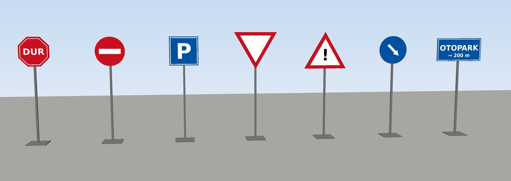

# gazebo-sign-injector

Turns a PNG image into a Gazebo traffic sign model. The script generates the
geometry itself: a face carrying the image, a back plate, a pole and a base.
No Blender and no mesh templates are needed, so adding a new sign only takes a
new image and one line in a CSV file.



*Seven models generated from PNG files with one command, rendered from the
generated meshes.*

## Usage

Python 3.8+ with no extra packages.

```bash
# one sign
python3 gazebo_sign_injector.py --name dur --shape octagon --png dur.png

# many signs
python3 gazebo_sign_injector.py --manifest signs.csv --out models
```

`signs.csv` has one sign per line: `name,shape,png[,width[,height]]`. PNG
paths are relative to the CSV file, and lines starting with `#` are skipped.

```csv
# name,shape,png[,width[,height]]
Dur,octagon,dur.png
Yol Ver,triangle_down,yol_ver.png,0.9
Otopark,rectangle,otopark.png,1.0,0.5
```

Names are turned into model names (`Yol Ver` → `yol_ver`, Turkish characters
included). All rows are checked before anything is written, and an existing
model folder is only replaced with `--force`.

| Option | Default | |
|---|---|---|
| `--size W [H]` | `0.6` | width in metres; rectangles take width and height |
| `--height` | `1.9` | height of the sign centre above the ground |
| `--no-pole` | | plate only, e.g. for signs mounted on something else |
| `--no-base` | | pole without the base plate |

## Shapes and images

| Shape | Image canvas |
|---|---|
| `circle`, `square`, `diamond`, `octagon` | square; the shape touches all four edges |
| `triangle`, `triangle_down` | width : height = 1 : 0.866 |
| `rectangle` | same aspect ratio as `--size W H` |

The image is stretched over the shape's bounding box, and anything outside
the shape is not shown.

## Output

```
models/dur/
  model.config
  model.sdf                      # visual + box collisions for plate, pole and base
  meshes/dur.dae
  materials/textures/dur.png
```

Add `models/` to `GAZEBO_MODEL_PATH` (Classic) or `GZ_SIM_RESOURCE_PATH`
(Fortress/Harmonic) and include the sign:

```xml
<include>
  <uri>model://dur</uri>
  <pose>10 -2 0 0 0 1.5708</pose>
</include>
```

The face looks towards -Y at yaw 0, so set the yaw so that it faces the
oncoming traffic. Each texture file is named after its model, because Gazebo
Classic caches textures by file name and signs that share a file name would
all show the same image.

## License

Apache-2.0
